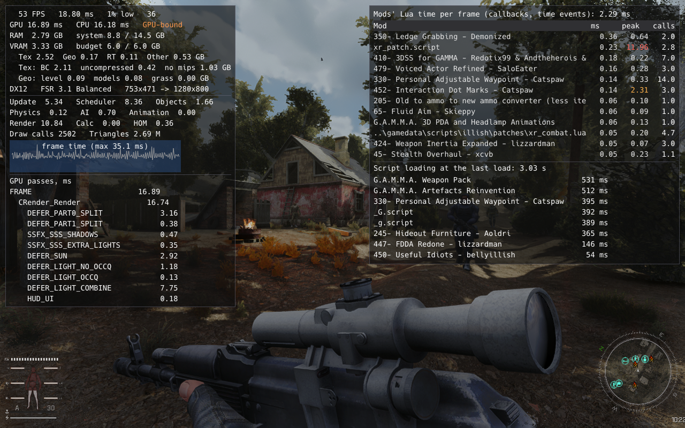
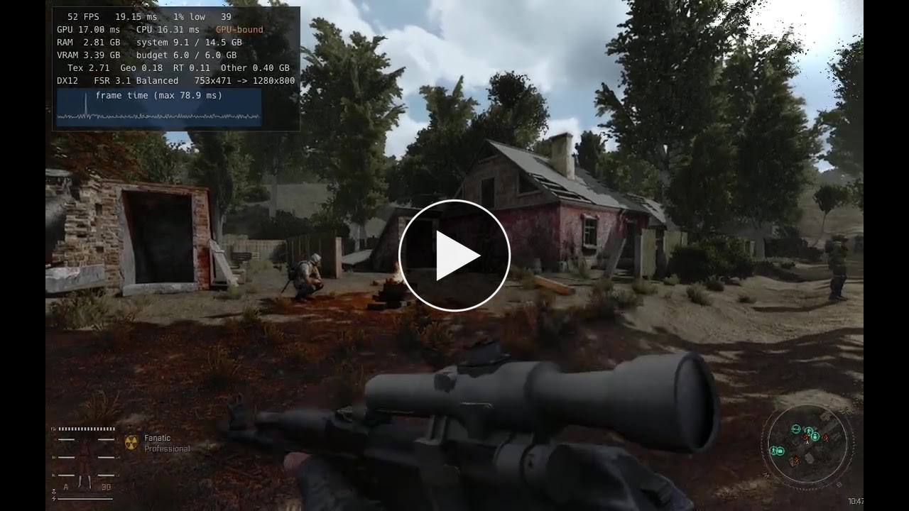
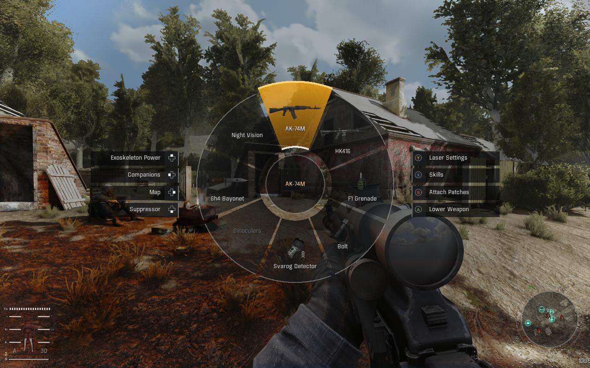
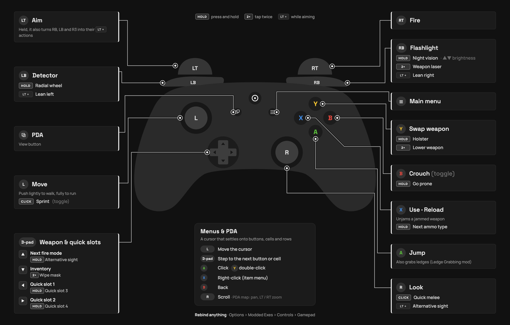

# neXt-Ray Engine

neXt-Ray is a new engine for S.T.A.L.K.E.R. Anomaly and [G.A.M.M.A.](https://github.com/Grokitach/Stalker_GAMMA)
It replaces the game's exes and leaves your modlist as it is. You get more fps, fewer stutters, faster loading and
lower memory use.

It is built on [Modded Exes](https://github.com/themrdemonized/xray-monolith) by themrdemonized, the engine GAMMA
ships with, so everything Modded Exes has is still here. The fork point is Modded Exes MT-TEST 2026.5.15, the engine
of GAMMA 0.9.5 (branch `all-in-one-vs2022-wpo-mt`, commit
[`3d4dcca5`](https://github.com/themrdemonized/xray-monolith/commit/3d4dcca52f842c797099da3e6206e53dab7e7d79)).

## Compatibility

- **Mods** (scripts, configs, textures, shaders): anything that works with GAMMA should work with neXt-Ray, since it
  is the same game with a different engine.
- **Mods that ship their own exes** (for example xrRazom co-op): these won't work. They need their own engine, and
  installing them would replace neXt-Ray.

## Install

neXt-Ray needs GAMMA 0.9.5 as the GAMMA launcher installs it. On the Steam Deck, follow the
[Steam Deck guide](docs/steam-deck/README.md) instead (GAMMA and neXt-Ray from scratch).

1. Download the latest zip from [Releases](../../releases).
2. Move two things out of your `Anomaly` folder into a backup folder outside it: `bin\AnomalyDX11AVX.exe` and the
   `gamedata` folder. GAMMA keeps its engine's scripts and shaders loose in `gamedata`, and loose files override
   neXt-Ray's.
3. Extract the zip into your `Anomaly` folder. It adds `bin\AnomalyDX11AVX.exe`, `bin\AnomalyDX12AVX.exe`, the DLSS
   and XeSS DLLs and the engine's gamedata (`db\mods\00_modded_exes_gamedata.db0`).
4. Add the DX12 exe to Mod Organizer: the executables list (the gears icon) > Add > Title `Anomaly (DX12-AVX)`,
   Binary `Anomaly\bin\AnomalyDX12AVX.exe`.
5. Start `Anomaly (DX12-AVX)` from Mod Organizer. DX11 is `Anomaly (DX11-AVX)`, as before.

Your saves, settings and modlist stay as they are. Only AVX exes are included.

**After a GAMMA update:** it can put GAMMA's own engine and its `gamedata` folder back and remove the DX12 entry from
Mod Organizer. Delete the new `gamedata` folder and do steps 3 and 4 again.

**Uninstall:** delete `bin\AnomalyDX12AVX.exe` and `db\mods\00_modded_exes_gamedata.db0`, then put the backed-up
exe and `gamedata` folder back.

neXt-Ray is not part of GAMMA: please don't report its problems to GAMMA's support, open an issue here instead.

## Features

### DirectX 12
<!-- screenshot -->
A new DX12 renderer with HDR. It is the main renderer: new features are made for it first. DX11 is still included
for older PCs and gets some of the updates, but not all of them (no frame generation or XeSS, for example).

### Upscaling
<!-- screenshot -->
NVIDIA DLSS 4, AMD FSR 3.1 and Intel XeSS.

### Frame generation
<!-- screenshot -->
FSR and XeSS frame generation.

### Texture streaming
<!-- screenshot -->
Textures load when they are needed instead of all at once. At full texture quality the game uses about 2.5x less
video memory; how much depends on the location (9.89 GB against 3.63 GB in the comparison below).

### General optimization

The same place with the same settings (1728x1080, no upscaler, no frame generation) on GAMMA's engine and on
neXt-Ray's DX12 renderer:

| | GAMMA engine | neXt-Ray | |
|---|---|---|---|
| FPS | 93 | 114 | +23% |
| 1% low FPS | 50 | 63 | +26% |
| CPU time per frame | 9.74 ms | 6.74 ms | -31% |
| Draw calls | 4904 | 2431 | -50% |
| Triangles | 3.51 M | 2.31 M | -34% |
| VRAM | 9.89 GB | 3.63 GB | -63% |

For the same picture neXt-Ray needs half the draw calls (hidden objects are skipped), a third less CPU time per
frame and about a third of the video memory.

GPU occlusion culling, tree batching, cached shadows, multithreaded culling, background Lua garbage collection, a
faster LuaJIT and A-Life work spread over several frames. The heaviest scripts and shaders of GAMMA's mods run
cheaper versions, without touching the mods' files. The image stays the same.

### Faster game startup, level transitions (fade to black) and loading

Up to ~2.5x faster loading on level transitions, with no loading screen. Above: the same transition on GAMMA's
engine (28.7 s) and on neXt-Ray (12.8 s), from the fade to black to the new level on screen.

Starting the game is about 2x faster too: from launch to a loaded save takes ~150 s on GAMMA's engine and ~76 s on
neXt-Ray on the same machine (launch to the main menu 107 s against 56 s, loading the save 42 s against 20 s).

### Performance overlay

A built-in overlay with FPS, frame times, CPU and GPU time and video memory (`perf_overlay compact`, `graph` or
`detailed` in the console). `perf_overlay_mods` adds the Lua time of each mod per frame and how long each took to load.

### Steam Deck preset

Actual performance and quality are higher: Steam's recording takes a hit on both.

One switch for the Steam Deck (Options > Video > Advanced) that lowers the settings whose loss is hard to see on its
800p screen: smaller shadow maps, ambient occlusion and reflections at half resolution, fewer shadow and indirect
light samples, 8x anisotropic filtering. Turning it off puts your previous values back.

### Gamepad (in progress)
Every button can be rebound in Options > Modded Exes > Controls > Gamepad.

## More
- [Features](docs/FEATURES.md): the full list, with console commands and defaults

## Remote console

For scripted tests: start the game with `-dbg -remote_console`. It runs the commands written to
`appdata/remote_cmd.txt` (one per line) and writes its state to `appdata/remote_status.txt`. Extra commands:
`rc_wait <s>`, `rc_wait_level <s>`, `rc_clear`, `rc_silent_level_changers 1`. `tools/remote_console.sh` wraps it
(launch, load a save, send commands, time a level transition).

## License

The X-Ray engine source is GSC Game World's, under its [license](License.txt): non-commercial use only. Third-party
code keeps its own license (`src/3rd party`).
