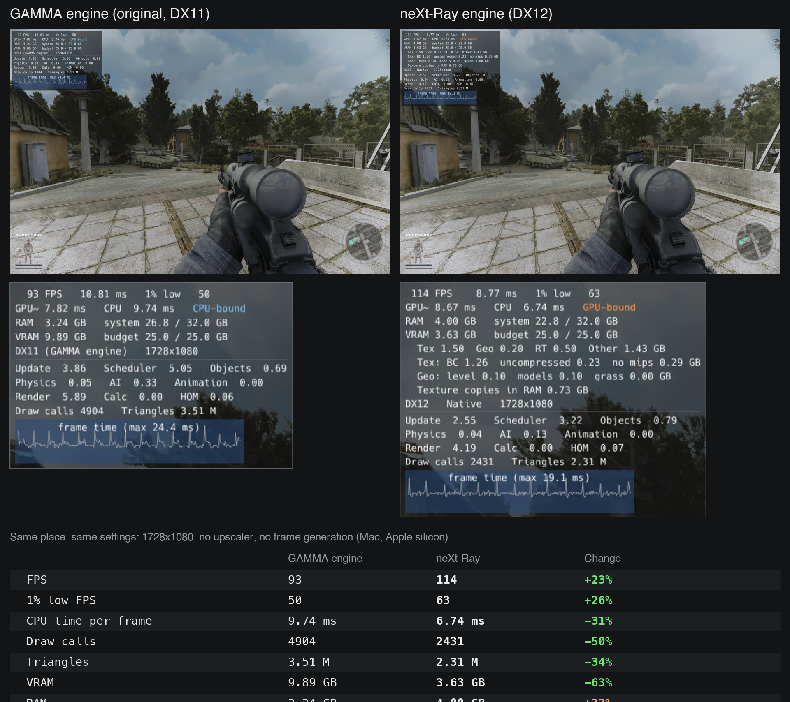
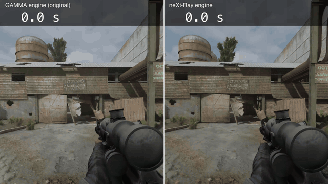

# neXt-Ray Engine

neXt-Ray is a new engine for S.T.A.L.K.E.R. Anomaly and [G.A.M.M.A.](https://github.com/Grokitach/Stalker_GAMMA)
It replaces the game's exes and leaves your modlist as it is. You get more fps, fewer stutters, faster loading and
lower memory use.

It is built on [Modded Exes](https://github.com/themrdemonized/xray-monolith) by themrdemonized, the engine GAMMA
ships with, so everything Modded Exes has is still here. The fork point is Modded Exes MT-TEST 2026.5.15, the engine
of GAMMA 0.9.5 (branch `all-in-one-vs2022-wpo-mt`, commit
[`3d4dcca5`](https://github.com/themrdemonized/xray-monolith/commit/3d4dcca52f842c797099da3e6206e53dab7e7d79)).

## Compatibility

- **Mods** (scripts, configs, textures, shaders): anything that works with GAMMA should work with neXt-Ray, since it
  is the same game with a different engine.
- **Mods that ship their own exes** (for example xrRazom co-op): these won't work. They need their own engine, and
  installing them would replace neXt-Ray.

## Features

### DirectX 12
<!-- screenshot -->
A new DX12 renderer with HDR. It is the main renderer: new features are made for it first. DX11 is still included
for older PCs and gets some of the updates, but not all of them (no frame generation or XeSS, for example).

### Upscaling
<!-- screenshot -->
NVIDIA DLSS 4, AMD FSR 3.1 and Intel XeSS.

### Frame generation
<!-- screenshot -->
FSR and XeSS frame generation.

### Texture streaming
<!-- screenshot -->
Textures load when they are needed instead of all at once. At full texture quality the game uses about 2.5x less
video memory; how much depends on the location (9.89 GB against 3.63 GB in the comparison below).

### General optimization

The same place with the same settings (1728x1080, no upscaler, no frame generation) on GAMMA's engine and on
neXt-Ray's DX12 renderer:

| | GAMMA engine | neXt-Ray | |
|---|---|---|---|
| FPS | 93 | 114 | +23% |
| 1% low FPS | 50 | 63 | +26% |
| CPU time per frame | 9.74 ms | 6.74 ms | -31% |
| Draw calls | 4904 | 2431 | -50% |
| Triangles | 3.51 M | 2.31 M | -34% |
| VRAM | 9.89 GB | 3.63 GB | -63% |

For the same picture neXt-Ray needs half the draw calls (hidden objects are skipped), a third less CPU time per
frame and about a third of the video memory.

GPU occlusion culling, tree batching, cached shadows, multithreaded culling, background Lua garbage collection, a
faster LuaJIT and A-Life work spread over several frames. The heaviest scripts and shaders of GAMMA's mods run
cheaper versions, without touching the mods' files. The image stays the same.

### Faster level transitions

Up to ~2.5x faster loading on level transitions, with no loading screen. Above: the same transition on GAMMA's
engine (28.7 s) and on neXt-Ray (12.8 s), from the fade to black to the new level on screen.

### Gamepad (in progress)
<!-- screenshot -->
Play with a controller: Xbox pads, DualSense and DualShock 4, with gyro aiming. Still being worked on.

## More
- [Features](docs/FEATURES.md): the full list, with console commands and defaults
- [Development](docs/DEVELOPMENT.md): building and testing

## License

The X-Ray engine source is GSC Game World's, under its [license](License.txt): non-commercial use only. Third-party
code keeps its own license (`src/3rd party`).
