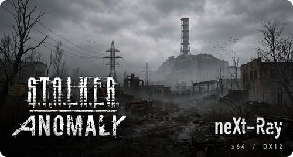

# neXt-Ray Engine

neXt-Ray is a new engine for S.T.A.L.K.E.R. Anomaly and [G.A.M.M.A.](https://github.com/Grokitach/Stalker_GAMMA)
It replaces the game's exes and leaves your modlist as it is. You get more fps, fewer stutters, faster loading and
lower memory use.

It is built on [Modded Exes](https://github.com/themrdemonized/xray-monolith) by themrdemonized, the engine GAMMA
ships with, so everything Modded Exes has is still here.

## Compatibility

- **Mods** (scripts, configs, textures, shaders): anything that works with GAMMA should work with neXt-Ray, since it
  is the same game with a different engine.
- **Mods that ship their own exes** (for example xrRazom co-op): these won't work. They need their own engine, and
  installing them would replace neXt-Ray.

## Features

### DirectX 12
<!-- screenshot -->
A new DX12 renderer with HDR. DX11 still gets updates too, for older PCs.

### Upscaling
<!-- screenshot -->
NVIDIA DLSS 4, AMD FSR 3.1 and Intel XeSS.

### Frame generation
<!-- screenshot -->
FSR and XeSS frame generation.

### Texture streaming
<!-- screenshot -->
Textures load when they are needed instead of all at once. At full texture quality, texture memory drops from
6.25 GB to about 2.6 GB.

### General optimization
<!--
| Modded Exes | neXt-Ray |
|---|---|
|  |  |
-->
GPU occlusion culling, tree batching, cached shadows, multithreaded culling, background Lua garbage collection, a
faster LuaJIT and A-Life work spread over several frames. The heaviest scripts and shaders of GAMMA's mods run
cheaper versions, without touching the mods' files. The image stays the same.

### Faster level transitions
<!-- video: cold and warm transition -->
Level transitions are up to 2.7x faster, with no loading screen.

### Gamepad (in progress)
<!-- screenshot -->
Play with a controller: Xbox pads, DualSense and DualShock 4, with gyro aiming. Still being worked on.

## More
- [Features](docs/FEATURES.md): the full list, with console commands and defaults
- [Development](docs/DEVELOPMENT.md): building and testing

## License

The X-Ray engine source is GSC Game World's, under its [license](License.txt): non-commercial use only. Third-party
code keeps its own license (`src/3rd party`).
